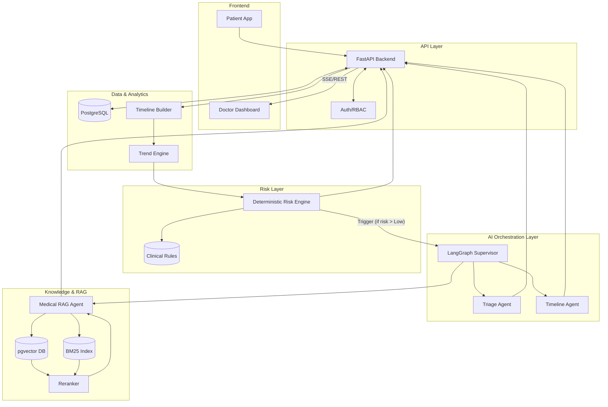
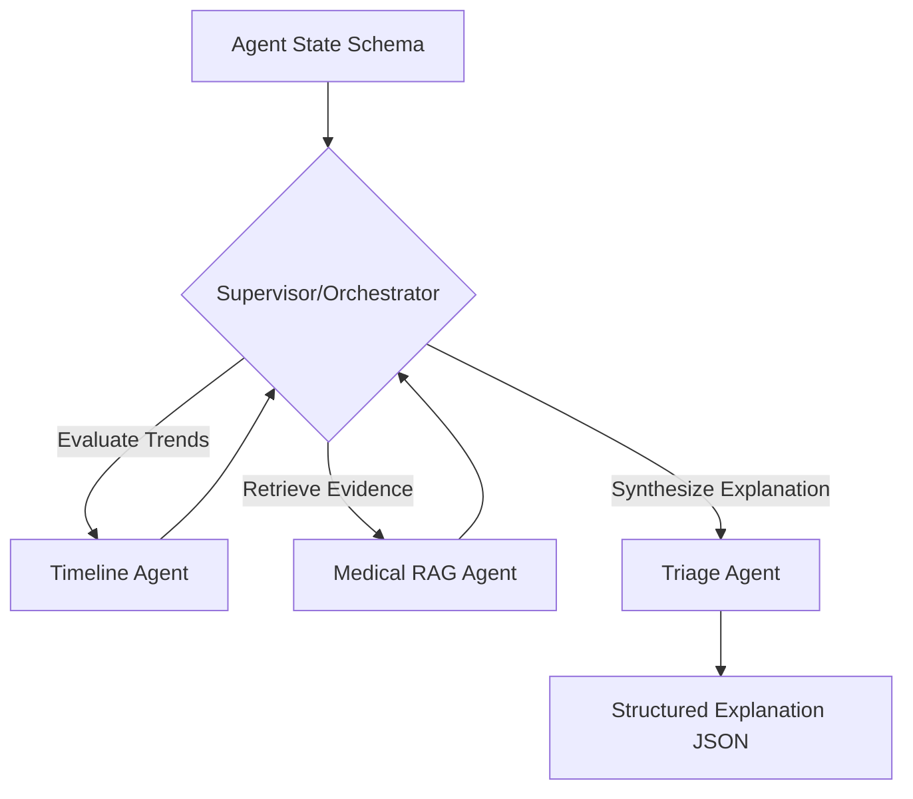
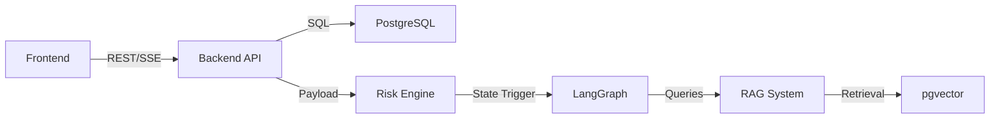

# Materna Architecture Overview

This document provides a high-level overview of the architecture for the Materna system, an AI-Powered Longitudinal Pregnancy Monitoring & Early-Warning System.

## System Overview
Materna utilizes a decoupled architecture where deterministic clinical risk calculation is entirely separated from AI reasoning. The system ingests longitudinal patient data, evaluates it against hard-coded clinical thresholds, and only then uses a multi-agent AI system to provide explainability, timeline context, and supporting medical literature.

## Core Architectural Principles
1. **DETECT → EXPLAIN → ESCALATE:** The fundamental operational paradigm. Detection is deterministic; explanation is AI-driven; escalation is deterministic.
2. **Deterministic Risk Calculation Separated from LLM Reasoning:** AI is never used to decide if a patient is at risk. Hardcoded clinical rules generate risk levels (🟢, 🟡, 🟠, 🔴). LLMs only explain the *context* of the flagged risk.
3. **Contracts-First Parallel Development:** Strict OpenAPI and Pydantic schemas separate frontend, backend, and AI agents, allowing 5 developers to build concurrently.
4. **Evidence Traceability:** Every AI explanation must be grounded in retrievable, verifiable medical literature (RAG) with exact citations.
5. **Module Independence:** The Risk Engine, RAG Pipeline, and Backend APIs function independently and communicate via clear interfaces.
6. **Failure Transparency:** If the AI subsystem fails, the deterministic Risk Engine still delivers critical alerts to the Doctor Dashboard (Graceful Degradation).
7. **CDSS Safety Positioning:** The architecture natively enforces that the system cannot act autonomously. It only highlights data for human review.

## End-to-End Pipeline
1. **Patient Data:** Patient enters vitals/symptoms via the Patient App.
2. **Validation:** FastAPI validates payloads against Pydantic schemas.
3. **Normalization:** Data is standardized (e.g., standardizing units of measurement).
4. **Patient Timeline:** The new data point is appended to the patient's longitudinal history in PostgreSQL.
5. **Trend Detection:** The Trend Engine calculates rates of change, rolling averages, and delta from the previous visit.
6. **Clinical Rules:** Data passes through deterministic risk definitions.
7. **Risk Assessment Engine:** Evaluates thresholds (e.g., BP > 140/90) and signal combinations (e.g., High BP + Headache).
8. **AI Interpretation:** The LangGraph Supervisor orchestrates analysis if risk is elevated.
9. **Medical RAG:** Retrieves relevant clinical guidelines based on the patient's specific presentation.
10. **Explainable Risk Signal:** The Triage Agent synthesizes the timeline and evidence into a concise, non-diagnostic explanation.
11. **Smart Escalation:** The system categorizes the urgency (LOW, MONITOR, CLINICAL REVIEW, HIGH PRIORITY).
12. **Doctor Dashboard:** The UI updates (via SSE) to surface the escalated patient to the clinical team.

## Full System Architecture

## Agent Workflow

## Module Breakdown

| Module | Core Responsibility |
| :--- | :--- |
| **Frontend** | Next.js apps for Patient (data entry) and Doctor (escalation dashboard). |
| **Backend API** | FastAPI layer for routing, auth, persistence, and business logic. |
| **Risk Engine** | Pure Python module with hardcoded logic for risk stratification. |
| **AI Agents** | LangGraph network for timeline summarization and clinical explanation. |
| **RAG Pipeline** | Hybrid retrieval (pgvector + BM25) and reranking pipeline for medical literature. |
| **Data Pipeline** | Constructs the longitudinal view and computes delta/trend features. |

## Critical Dependency Graph

## Inter-Component Contracts
To enable parallel development, the following contracts apply to Materna:
*   **C-001: Data Ingestion:** Standardized JSON payload for vitals and symptoms.
*   **C-002: Timeline State:** Standardized format for patient history passed to the Trend Engine.
*   **C-003: Risk Output:** Strict JSON schema defining `risk_level` and `triggered_rules`.
*   **C-004: Agent State:** LangGraph state definition containing timeline, risk output, and agent scratchpad.
*   **C-005: RAG Request/Response:** Schema for querying medical texts and returning chunked citations.
*   **C-006: Frontend Alert Notification:** SSE payload structure for real-time dashboard updates.

Refer to individual directory READMEs for deeper technical implementation details.
