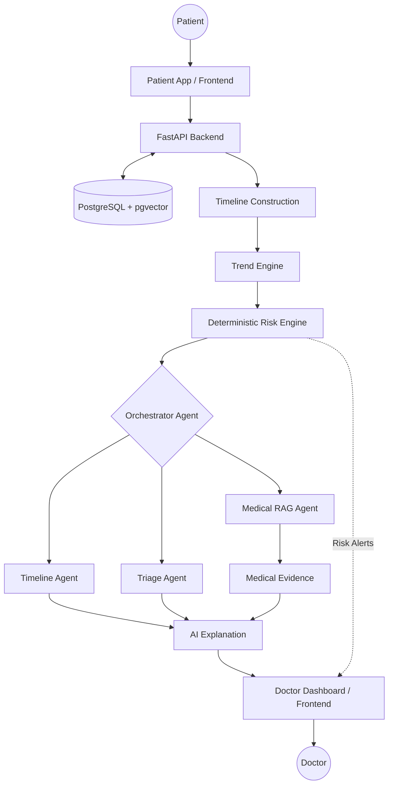

# Materna — AI-Powered Longitudinal Pregnancy Monitoring & Early-Warning System

**Materna** is a Clinical Decision Support System (CDSS) designed to track, analyze, and escalate critical changes in a patient's pregnancy journey.

## The Core Problem
During pregnancy, patient data is often collected at separate, isolated visits. Critical changes and subtle trends between these visits (such as a gradual increase in blood pressure or an onset of specific symptoms) can be easily missed until they become emergencies. Materna bridges this gap by continuously monitoring longitudinal data.

## Core Principle: DETECT → EXPLAIN → ESCALATE
1. **DETECT:** A deterministic Risk Engine constantly evaluates longitudinal data (vitals, symptoms, labs) against established clinical thresholds to identify anomalies or dangerous trends.
2. **EXPLAIN:** Specialized AI agents analyze the patient's timeline and retrieve medical evidence via RAG to explain *why* the data is concerning.
3. **ESCALATE:** The system intelligently surfaces actionable, color-coded alerts to healthcare providers for clinical review.

## Key Features
*   **Patient Profile & Daily Check-in:** Easy tracking of vitals and symptoms for expectant mothers.
*   **Longitudinal Timeline:** A unified view of the patient's entire pregnancy journey.
*   **Trend Detection:** Analytics that calculate rates of change and consecutive abnormal readings.
*   **Deterministic Risk Engine:** Rule-based logic completely separated from LLM reasoning to ensure safety and predictability.
*   **Multi-Agent AI Orchestration:** Specialized agents (Supervisor, Triage, Timeline, Medical RAG) to generate clinical context.
*   **Smart Escalation Dashboard:** A prioritized doctor-facing UI that highlights patients requiring immediate attention.

## Tech Stack

| Layer | Technologies |
| :--- | :--- |
| **Frontend** | Next.js 14, TypeScript, Tailwind CSS |
| **Backend** | FastAPI, Python, Pydantic |
| **Database** | PostgreSQL, pgvector |
| **AI Orchestration**| LangGraph |
| **RAG Pipeline** | Embeddings, Vector DB, BM25, Reranker |

## Architecture Overview

## Quick Start
*(Placeholder - instructions for running Docker compose, setting up `.env` files, and applying database migrations will be added here).*

## Documentation Map
*   [Architecture Overview](./ARCHITECTURE.md)
*   [Product Requirements Document (PRD)](./product/PRD.md)
*   [System Requirements](./product/REQUIREMENTS.md)
*   [Patient Onboarding Baseline](./product/ONBOARDING_REQUIREMENTS.md)
*   [Daily Patient Check-in](./product/DAILY_CHECKIN.md)
*   [Phases & Roadmap](./management/PHASES_ROADMAP.md)
*   [Team Task Assignments](./management/TEAM_TASKS.md)

## Team Ownership

| Developer | Role & Responsibilities |
| :--- | :--- |
| **Dev 1** | **AI / Multi-Agent:** LangGraph, Supervisor, Triage/Timeline agents, Agent State, AI Explanation. |
| **Dev 2** | **Data / RAG:** Knowledge ingestion, Chunking, Embeddings, Vector DB, BM25, Reranking, Evidence pipeline, Trend features. |
| **Dev 3** | **Risk / Clinical Logic:** Risk rules, Thresholds, Signal combinations, Risk levels, Escalation logic, Rule testing. |
| **Dev 4** | **Backend / Database:** FastAPI, PostgreSQL, API layer, Data models, Auth, Persistence, Integration. |
| **Dev 5** | **Frontend:** Patient/Doctor UX, Timeline visualization, Risk visualization, Evidence UI, Alerts. |

> [!WARNING]
> **Safety Disclaimer:** Materna is a Clinical Decision Support System (CDSS). It does **not** diagnose conditions, prescribe treatments, or replace the clinical judgment of qualified healthcare professionals. It solely highlights data trends and correlates them with medical literature.

## License
*(Placeholder)*
