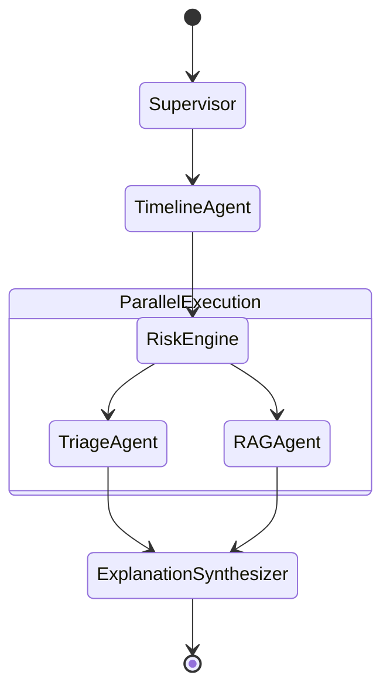

# LangGraph Shared State Schema

## Overview
Materna utilizes LangGraph to orchestrate its multi-agent workflow. The core of this orchestration is the `AgentState` object, which is passed between nodes, updated incrementally, and acts as the single source of truth for a given execution run.

## State Definition (TypedDict)

```python
from typing import TypedDict, Annotated, Optional, List
from operator import add

class AgentState(TypedDict):
    pregnancy_context: 'PregnancyContext'
    current_symptoms: List['Symptom']
    current_vitals: 'VitalSigns'
    historical_data: List['HistoricalRecord']
    
    # Updated by Timeline Agent
    timeline_analysis: Optional['TimelineAnalysis']
    trend_features: Optional[List['TrendFeature']]
    
    # Updated by Risk Engine (Deterministic)
    rule_results: Optional[List['RuleResult']]
    risk_level: Optional['RiskLevel']
    risk_signals: Optional[List['RiskSignal']]
    
    # Updated by RAG Agent
    evidence: Optional[List['EvidenceItem']]
    
    # Updated by Triage Agent
    explanation: Optional['ExplainableRiskSignal']
    
    # Orchestration metadata
    agent_outputs: Annotated[List['AgentOutput'], add]
    agent_errors: Annotated[List['AgentError'], add]
    current_agent: Optional[str]
    status: str
```

## Core Pydantic Models

### PregnancyContext
```python
from pydantic import BaseModel
from typing import Optional, List

class PregnancyContext(BaseModel):
    patient_id: str
    pregnancy_id: str
    gestational_week: float
    trimester: int
    gravida: int
    para: int
    blood_type: str
    rh_factor: str
    is_multiple: bool
    chronic_conditions: List[str]
    estimated_due_date: str
```

*(Note: Other models like `Symptom`, `VitalSigns`, `TrendFeature`, `RuleResult`, `RiskSignal`, `EvidenceItem`, and `ExplainableRiskSignal` are defined in their respective module documentation.)*

## State Transition Diagram



## Reducer Functions
The `AgentState` utilizes LangGraph's `Annotated[..., add]` syntax for specific fields (e.g., `agent_outputs` and `agent_errors`). The `add` operator ensures that when multiple agents run in parallel (like Triage and RAG), their outputs and errors are appended to the list rather than overwriting each other. All other fields are overwritten by the most recent node's output.
