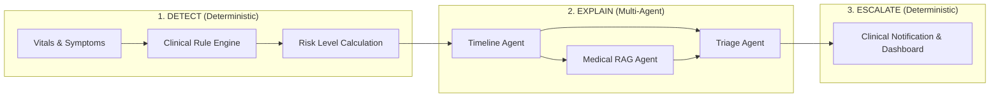
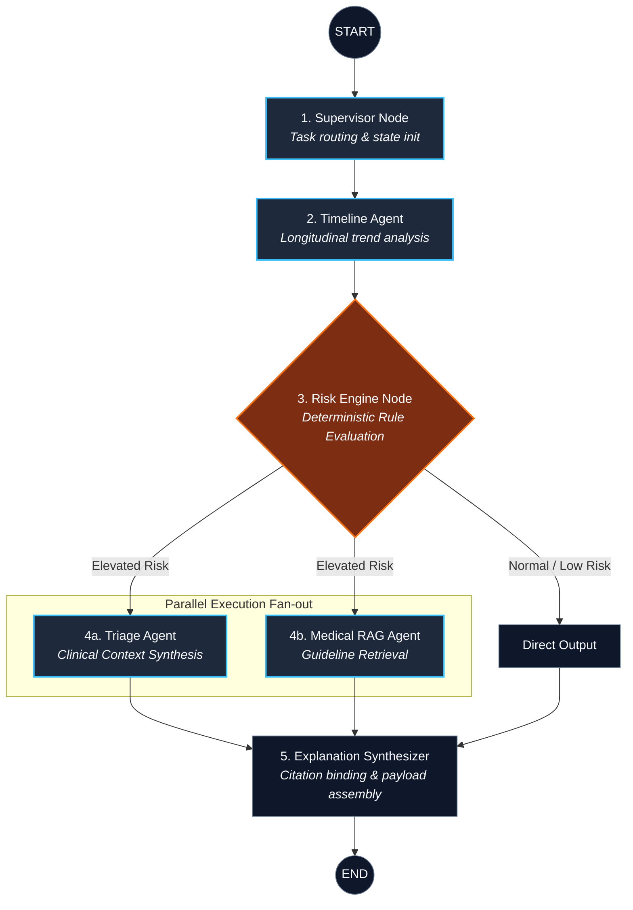
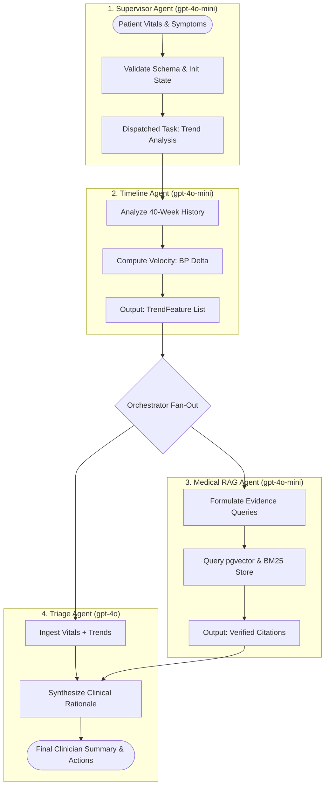
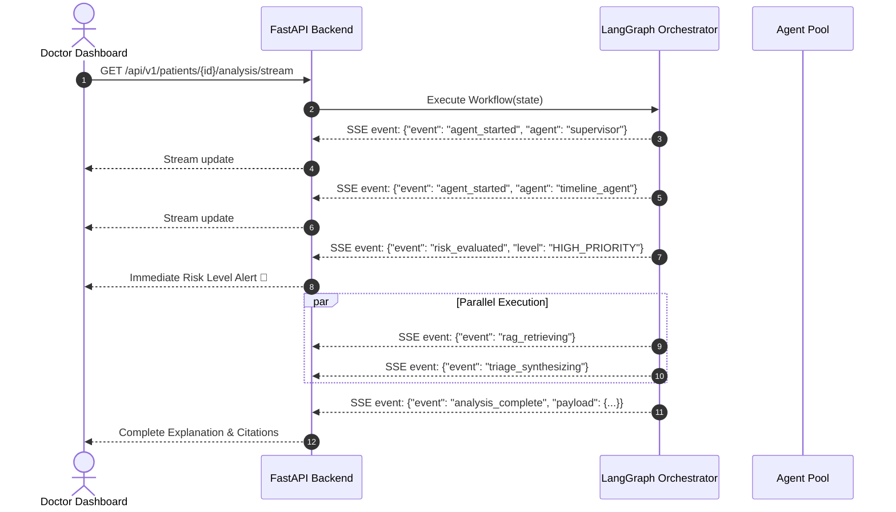

# Multi-Agent Architecture Specification

## Overview

The Materna AI multi-agent subsystem is built on **LangGraph** to coordinate specialized agents and deterministic evaluation nodes. It enforces a strict separation between **deterministic clinical risk detection** and **probabilistic LLM explanation**, adhering to Clinical Decision Support System (CDSS) safety guidelines.

---

## 1. Core Architectural Paradigm: DETECT → EXPLAIN → ESCALATE



---

## 2. Multi-Agent Topology & Execution Graph

The execution topology combines sequential preprocessing, deterministic safety gating, parallel agent fan-out, and synthesis fan-in.



---

### 2.1 Dedicated 4-Agent Collaborative Intelligence Workflow



---

## 3. Agent Roster & Specifications

| Agent / Node | Type | Model / Engine | Responsibilities | Input Contract | Output Contract |
| :--- | :--- | :--- | :--- | :--- | :--- |
| **Supervisor** | LLM / Router | `gpt-4o-mini` (T: 0.1) | State validation, input normalization, execution path orchestration | Raw patient event, history | Validated `AgentState`, active routes |
| **Timeline Agent** | LLM / Tool | `gpt-4o-mini` (T: 0.1) | Analyzes longitudinal trends, rate of change, baseline delta, and gestational trajectory | Full longitudinal visits, current vitals | `TimelineAnalysis`, `List[TrendFeature]` |
| **Risk Engine** | **Deterministic** | Hardcoded Rules (Python) | Evaluates gestational thresholds and co-occurring symptom logic. **LLMs cannot override this.** | Timeline features, current vitals | `RiskScore`, `RiskLevel`, `List[RuleResult]` |
| **Medical RAG Agent** | LLM / Retrieval | `gpt-4o-mini` (T: 0.1) | Formulates clinical queries, searches pgvector + BM25 index, applies Cohere reranking | Risk signals, symptom profile | `EvidenceCollection`, `List[Citation]` |
| **Triage Agent** | LLM / Explainer | `gpt-4o` (T: 0.2) | Synthesizes timeline, deterministic risk level, and RAG citations into clear, non-diagnostic clinician summaries | Risk assessment, timeline, RAG evidence | `ExplainableRiskSignal`, summary, next steps |
| **Explanation Synthesizer** | Deterministic Node | Python Reducer | Aggregates outputs from parallel branches, enforces safety disclaimers, and packages final response | Parallel node outputs | `FinalClinicalPayload` |

---

## 4. Shared State Schema (`AgentState`)

```python
from typing import Annotated, List, Optional, Dict, Any
from pydantic import BaseModel, Field
import operator

class VitalSigns(BaseModel):
    systolic_bp: int
    diastolic_bp: int
    heart_rate: int
    fetal_heart_rate: Optional[int] = None
    weight_kg: float
    blood_glucose: Optional[float] = None
    proteinuria: Optional[str] = None  # "+1", "+2", "trace", "negative"

class TrendFeature(BaseModel):
    metric: str
    delta_previous: float
    rate_of_change_per_week: float
    is_accelerating: bool
    baseline_value: float

class RuleResult(BaseModel):
    rule_id: str
    rule_name: str
    severity: str  # "LOW", "MONITOR", "CLINICAL_REVIEW", "HIGH_PRIORITY"
    matched_conditions: List[str]

class Citation(BaseModel):
    chunk_id: str
    text_snippet: str
    source_title: str
    organization: str  # "WHO", "ACOG", "NICE", "SMFM"

class AgentOutput(BaseModel):
    agent_name: str
    timestamp: str
    payload: Dict[str, Any]

class AgentState(BaseModel):
    # Core Context
    patient_id: str
    gestational_age_weeks: int
    current_vitals: VitalSigns
    reported_symptoms: List[str]
    longitudinal_history: List[Dict[str, Any]]

    # Pipeline State (Iteratively updated)
    timeline_trends: Optional[List[TrendFeature]] = None
    deterministic_risk_level: Optional[str] = None
    evaluated_rules: Optional[List[RuleResult]] = None
    retrieved_citations: Optional[List[Citation]] = None
    triage_explanation: Optional[str] = None
    recommended_clinical_actions: Optional[List[str]] = None

    # Reducer-Accumulated Fields (Parallel Safe)
    agent_outputs: Annotated[List[AgentOutput], operator.add] = Field(default_factory=list)
    agent_errors: Annotated[List[str], operator.add] = Field(default_factory=list)
    
    # Metadata
    execution_id: str
    status: str = "IN_PROGRESS"  # "IN_PROGRESS", "SUCCESS", "DEGRADED", "FAILED"
```

---

## 5. LangGraph Implementation Blueprint

```python
from langgraph.graph import StateGraph, END
from typing import Dict, Any

# 1. Initialize Graph
workflow = StateGraph(AgentState)

# 2. Add Processing Nodes
workflow.add_node("supervisor", supervisor_node)
workflow.add_node("timeline_agent", timeline_agent_node)
workflow.add_node("risk_engine", deterministic_risk_engine_node)
workflow.add_node("triage_agent", triage_agent_node)
workflow.add_node("rag_agent", rag_agent_node)
workflow.add_node("synthesizer", explanation_synthesizer_node)

# 3. Define Flow Edges
workflow.set_entry_point("supervisor")
workflow.add_edge("supervisor", "timeline_agent")
workflow.add_edge("timeline_agent", "risk_engine")

# 4. Conditional Branching from Risk Engine
def route_after_risk_engine(state: AgentState) -> List[str]:
    """Fan out to Triage and RAG in parallel if risk evaluation warrants explanation."""
    if state.deterministic_risk_level in ["MONITOR", "CLINICAL_REVIEW", "HIGH_PRIORITY"]:
        return ["triage_agent", "rag_agent"]
    return ["synthesizer"]

workflow.add_conditional_edges(
    "risk_engine",
    route_after_risk_engine,
    {
        "triage_agent": "triage_agent",
        "rag_agent": "rag_agent",
        "synthesizer": "synthesizer"
    }
)

# 5. Fan-in Edges to Synthesizer
workflow.add_edge("triage_agent", "synthesizer")
workflow.add_edge("rag_agent", "synthesizer")
workflow.add_edge("synthesizer", END)

# 6. Compile Graph
app = workflow.compile()
```

---

## 6. Real-Time Server-Sent Events (SSE) Streaming

To ensure clinicians receive zero-latency feedback as each agent executes, the orchestrator streams events across lifecycle hooks:



---

## 7. Safety & Fail-Safe Matrix (Graceful Degradation)

| Failure Scenario | Impact | Fallback / Degradation Strategy |
| :--- | :--- | :--- |
| **LLM Provider Outage (OpenAI Down)** | Triage / Supervisor agents fail | Graph falls back to pure **Deterministic Rule Engine**. Clinician receives raw risk flag (e.g. `HIGH PRIORITY: Systolic BP > 160`) with disclaimer: *"AI Explanation Unavailable"*. |
| **Vector DB / RAG Failure** | Evidence retrieval unavailable | Triage Agent continues with baseline clinical rules, marking citations as `[Literature unavailable for this query]`. |
| **Agent Timeout (> 15s)** | Execution stalled | LangGraph terminates the offending node, appends timeout to `agent_errors`, and completes synthesis in `DEGRADED` mode. |
| **Prompt Injection / Hallucination** | LLM attempts diagnostic override | Schema validators and the Deterministic Guardrail strictly prevent the LLM from altering `deterministic_risk_level` or suggesting prescriptions. |
