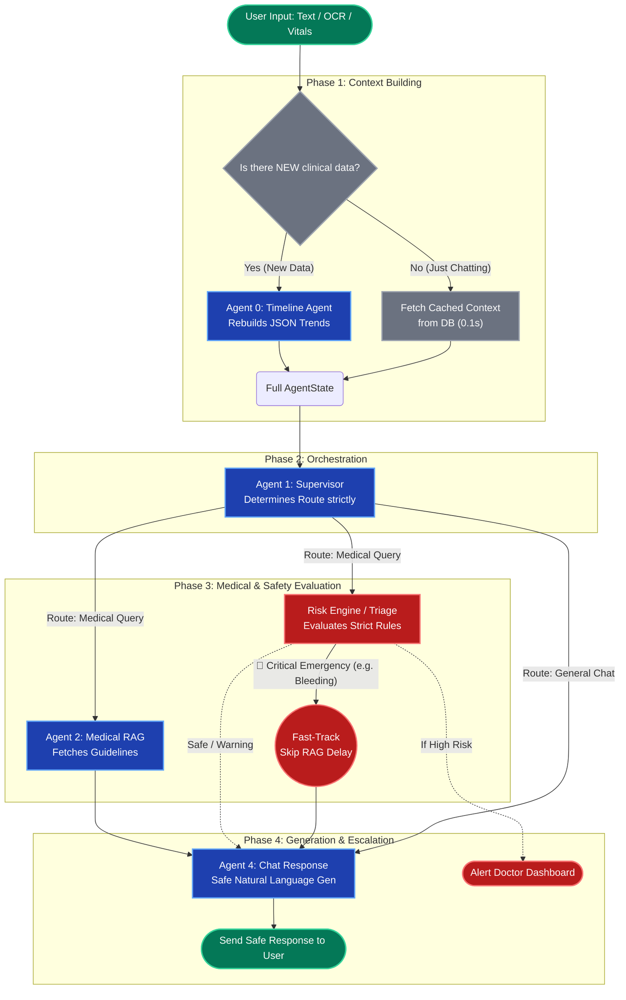

# 🧠 Multi-Agent Architecture (Timeline-First)

The Materna CDSS AI layer utilizes a robust **Timeline-First** multi-agent topology using LangGraph. This ensures that every interaction is grounded in longitudinal clinical context before any routing or medical reasoning occurs.

## The 5-Node Topology

## Agents Overview

1. **Agent 0: Timeline Agent**
   - **Role**: Longitudinal summarization.
   - **Action**: Converts raw vitals and history into a structured `TimelineContext`.

2. **Agent 1: Supervisor (Router)**
   - **Role**: Traffic Controller.
   - **Action**: Receives the `TimelineContext` and user message, then routes the flow. Does NOT perform medical reasoning.

3. **Agent 2: Medical RAG Agent**
   - **Role**: Knowledge Retrieval.
   - **Action**: Queries the `pgvector` database for WHO/ACOG guidelines.

4. **Agent 3: Triage / Risk Engine**
   - **Role**: Safety & Deterministic Logic.
   - **Action**: Applies hardcoded thresholds (e.g., BP > 160). Can trigger the "Fast-Track" emergency escape hatch.

5. **Agent 4: Chat Response Agent**
   - **Role**: Natural Language Generation.
   - **Action**: Synthesizes the final message to the patient, ensuring empathetic tone and strict adherence to the triage safety level.
