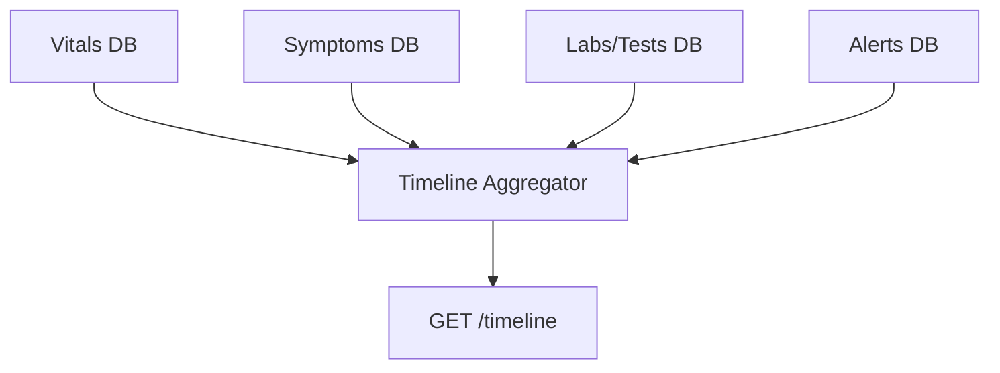

# Timeline API

The Timeline API unifies all patient interactions, vitals, symptoms, and alerts into a single chronological sequence.

## Architecture



---

## `GET /api/v1/pregnancies/{id}/timeline`
Retrieve a unified timeline of all events.
**Query Parameters**: `from_week`, `to_week`, `event_type` (vitals/symptoms/alert/risk), `page`, `page_size`
**Auth**: `doctor`, `patient` (own)

### Response `200 OK`
```json
{
  "status": "success",
  "data": [
    {
      "event_id": "evt-001",
      "event_type": "vitals",
      "gestational_week": 24,
      "event_date": "2024-02-20T10:00:00Z",
      "event_data": {
        "systolic_bp": 140,
        "diastolic_bp": 90
      },
      "risk_level_at_time": "low"
    },
    {
      "event_id": "evt-002",
      "event_type": "alert",
      "gestational_week": 24,
      "event_date": "2024-02-20T10:05:00Z",
      "event_data": {
        "priority": "high",
        "message": "Elevated blood pressure detected."
      },
      "risk_level_at_time": "moderate"
    }
  ],
  "meta": {
    "page": 1,
    "page_size": 50,
    "total": 120,
    "total_pages": 3
  },
  "error": null
}
```

---

## `GET /api/v1/pregnancies/{id}/timeline/summary`
Get an aggregated summary of the pregnancy timeline to date.
**Auth**: `doctor`, `patient` (own)

### Response `200 OK`
```json
{
  "status": "success",
  "data": {
    "gestational_age_weeks": 24,
    "trimester": 2,
    "weeks_until_due_date": 16,
    "total_visits": 6,
    "current_risk_level": "moderate",
    "risk_trend": "increasing",
    "event_counts": {
      "vitals": 12,
      "symptoms": 4,
      "alerts": 2,
      "risk_assessments": 3
    }
  },
  "meta": null,
  "error": null
}
```
