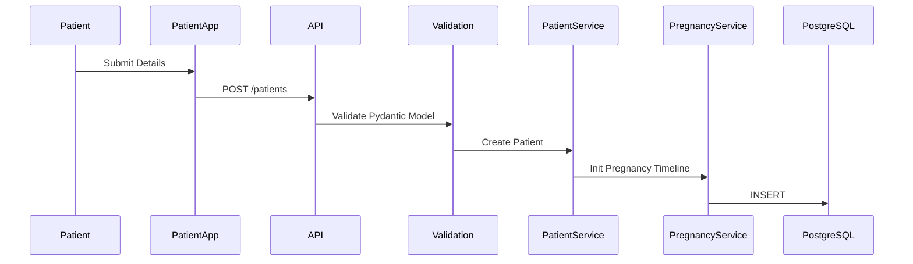
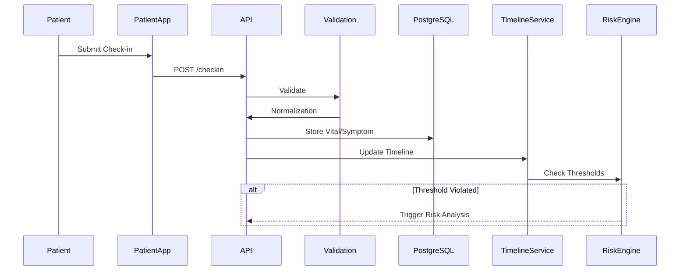
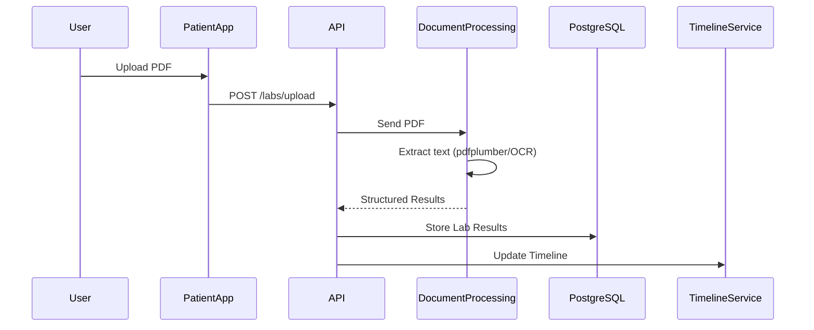
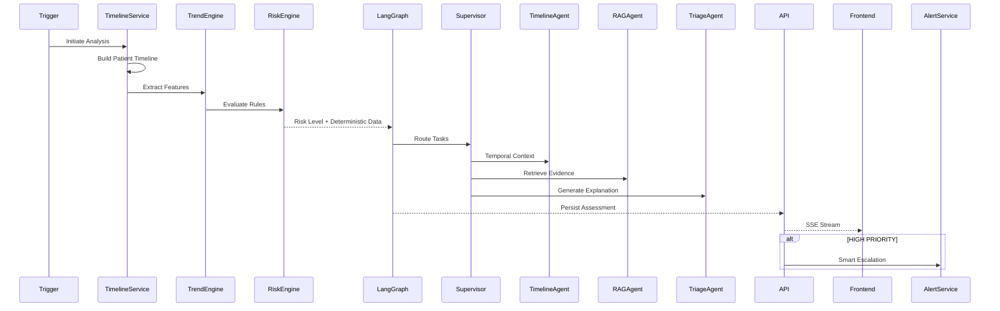
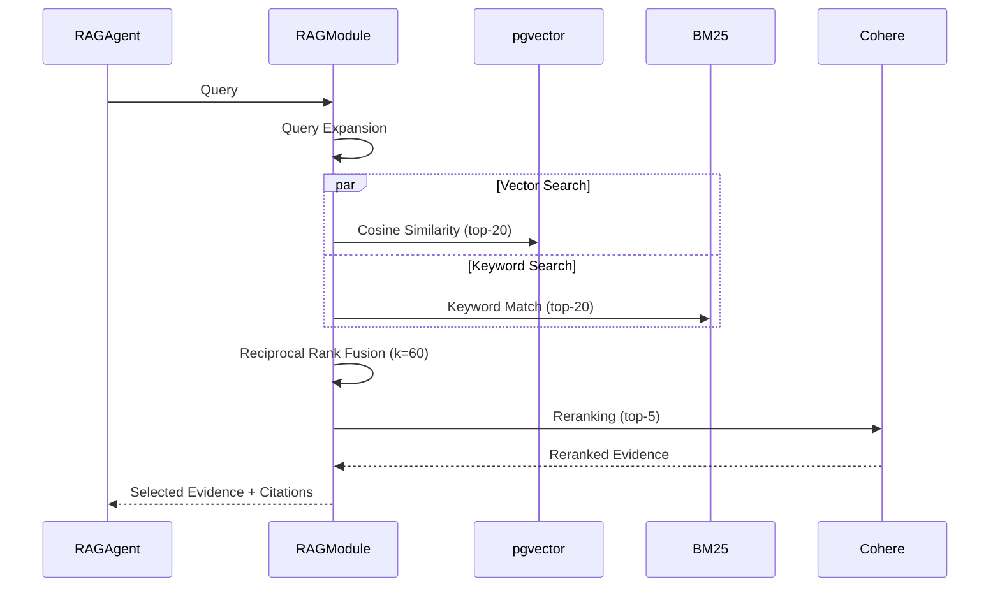

# Data Flow Architectures

## Flow 1: Patient Onboarding & Pregnancy Registration

## Flow 2: Daily Check-In (Symptoms + Vitals)

## Flow 3: Lab Report Processing

## Flow 4: Risk Analysis Pipeline (Core Flow)

## Flow 5: Evidence Retrieval (Hybrid RAG)

## Data Lifecycle Rules
- **Immutable Clinical Records:** Once written, vitals and assessments are append-only. Corrections require a new entry.
- **Cascade Deletion:** Patient deletion cascades to pregnancies, timelines, and assessments.
- **Audit Trail:** All risk assessments and the deterministic data used to generate them are permanently logged.
