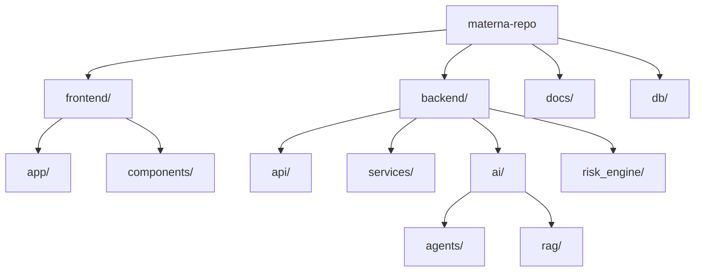

# Materna: Architectural Overview

Materna is an AI-Powered Longitudinal Pregnancy Monitoring & Early-Warning System. Its core principle is **DETECT → EXPLAIN → ESCALATE**.

## Architectural Principles

1. **Decision-Support Positioning:** Materna is a Clinical Decision Support System (CDSS). It provides insights and recommendations but NEVER makes autonomous diagnoses or definitive treatment decisions.
2. **DETECT → EXPLAIN → ESCALATE:** The system detects anomalies via a deterministic risk engine, explains them using AI agents, and escalates appropriately.
3. **Deterministic Risk Separation:** The Risk Engine (evaluating rules, thresholds, and trends) is strictly separated from LLM reasoning. The LLM only explains the deterministic outcome; it does not decide the risk level.
4. **Contracts-First Development:** To support 5-developer parallel development, all inter-component interfaces are frozen contracts. 
5. **Evidence Traceability:** Every medical explanation must be traceable: source → chunk → citation → explanation.
6. **Longitudinal-First Data Model:** Pregnancy is a journey. Data structures are designed around time-series and continuous patient monitoring.
7. **Module Independence:** Frontend, Backend API, AI Orchestration, and the Risk Engine operate as loosely coupled modules.
8. **Failure Transparency:** If the AI fails, falls back gracefully. If data is missing, the system degrades safely and transparently.

## Technology Stack

| Component | Technology | Justification |
|-----------|------------|---------------|
| Frontend | Next.js 14, TypeScript, Tailwind | Server-side rendering, type safety, and rapid UI development. |
| Backend API | FastAPI, Python 3.11, Pydantic | High performance, async support, ideal for data science/AI integration. |
| Database | PostgreSQL 15, pgvector | Relational data integrity for medical records + vector search for RAG. |
| AI Orchestration | LangGraph | State machine-based agent orchestration for complex multi-agent workflows. |
| Embeddings | text-embedding-3-small | Efficient and accurate embeddings for medical literature. |
| Reranker | Cohere | Improved retrieval accuracy on complex medical queries. |
| Search | BM25 + Vector (Hybrid) | Captures both exact medical terminology and semantic meaning. |

## Hard Constraints
- **NO Autonomous Diagnosis:** System must operate strictly as CDSS.
- **Traceability:** AI explanations MUST cite established medical guidelines.
- **Latency:** SSE streaming must begin within 2 seconds of a request.
- **Security:** PHI must be protected; database must support encryption at rest.

## Soft Constraints
- Optimize for mobile-first views on the Patient App.
- Keep AI token usage optimized to reduce operational costs.

## Quality Attributes
- **Safety:** Clinical rules act as a hard boundary against hallucination.
- **Traceability:** Robust RAG citation chain.
- **Reliability:** Graceful degradation on LLM API failure.
- **Performance:** Async backend, SSE for perceived performance.
- **Security:** Role-based access control (Doctor vs. Patient).

## Repository Structure

## ADR References
- ADR-001: Separation of Deterministic Risk and AI Explanation
- ADR-002: Usage of LangGraph for Agent Orchestration
- ADR-003: Hybrid RAG Strategy with pgvector
