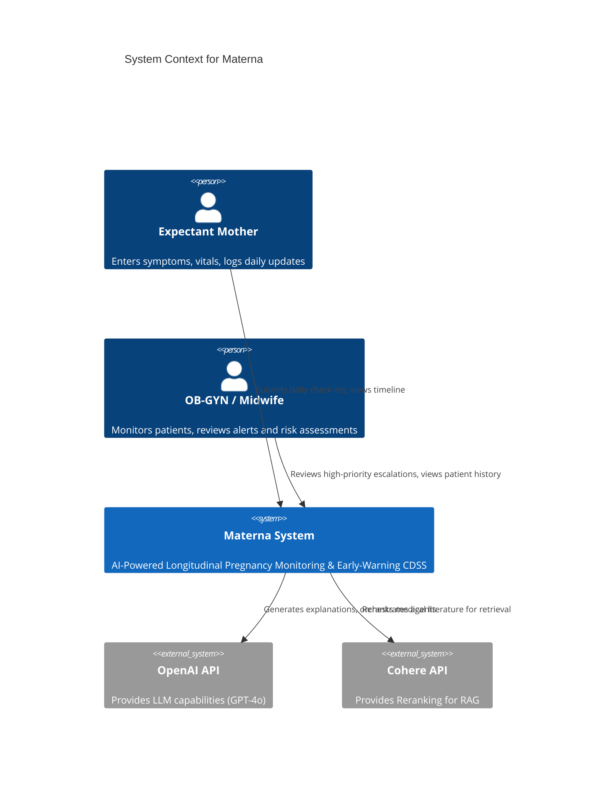
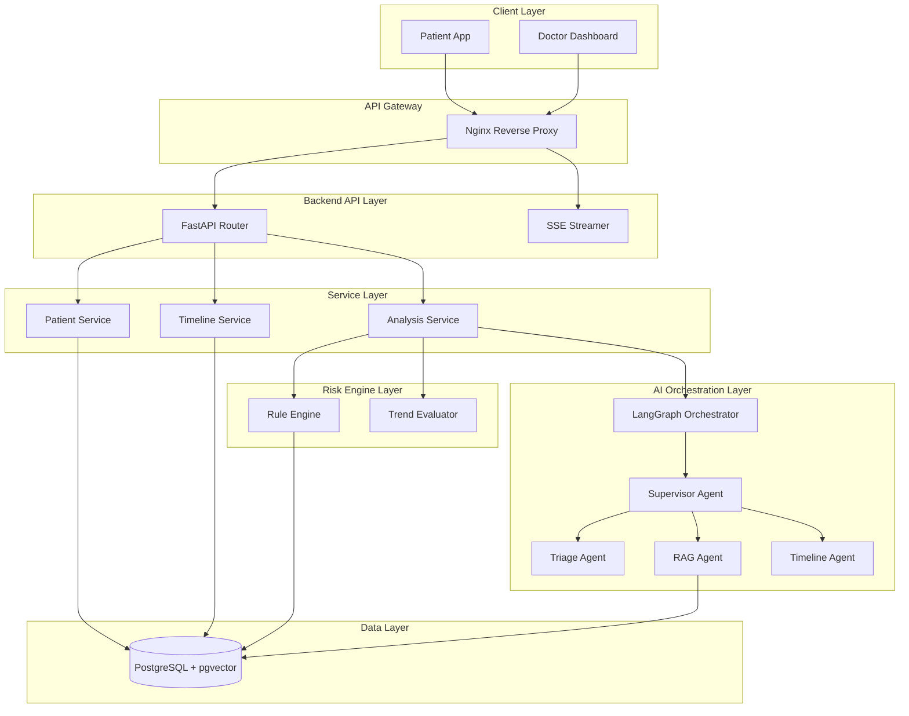
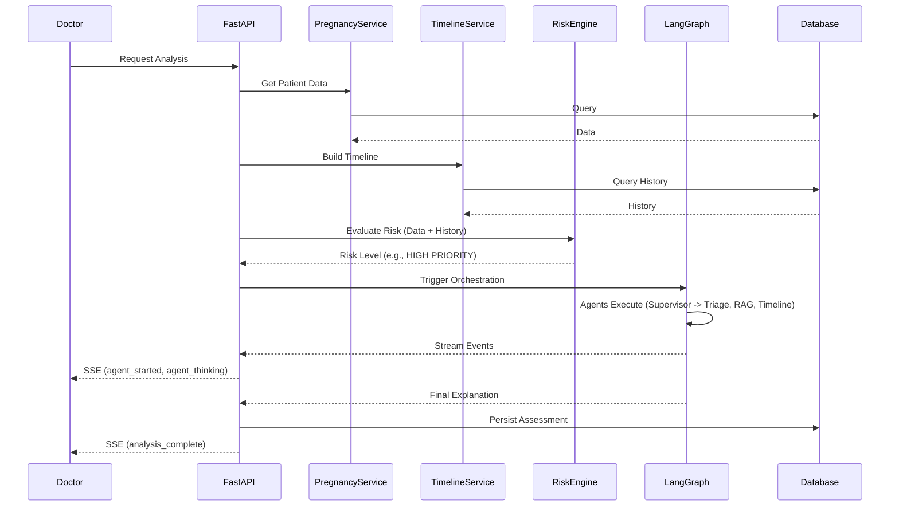

# System Architecture

## C4 Context Diagram

## 7-Layer Architecture Breakdown

1. **Client Layer:** Patient App (mobile-first), Doctor Dashboard (desktop-optimized). Next.js UI components.
2. **API Gateway:** Nginx reverse proxy handling SSL, routing, and SSE support (proxy buffering disabled).
3. **API Layer:** FastAPI exposing RESTful endpoints and Server-Sent Events (SSE) streaming endpoints.
4. **Service Layer:** Core business logic (PatientService, PregnancyService, TimelineService, AnalysisService, EvidenceService).
5. **AI Orchestration Layer:** LangGraph coordinating 4 specialized agents.
6. **Risk Engine Layer:** Deterministic evaluation combining Clinical Rules, Thresholds, and the Trend Analyzer.
7. **Data Layer:** PostgreSQL with pgvector for relational data and time-series embeddings.

## Full System Block Diagram

## Communication Patterns
- **REST (CRUD):** Standard synchronous requests for data fetching, user profiles, and manual inputs.
- **SSE (Server-Sent Events):** Asynchronous one-way streaming from Backend to Frontend to deliver real-time agent execution status and final AI explanations.
- **In-process:** Python service layer calls, LangGraph state transitions.

## End-to-End Sequence Diagram

## Scalability Considerations (Post-MVP)
- **Database Scaling:** Read replicas for PostgreSQL to handle intensive vector searches.
- **Async Workers:** Moving AI Orchestration to Celery/RabbitMQ if SSE connection holding becomes a bottleneck under high load.
- **Microservices:** Separating the Risk Engine into a standalone Go/Rust service for extremely high-throughput rule evaluation.
