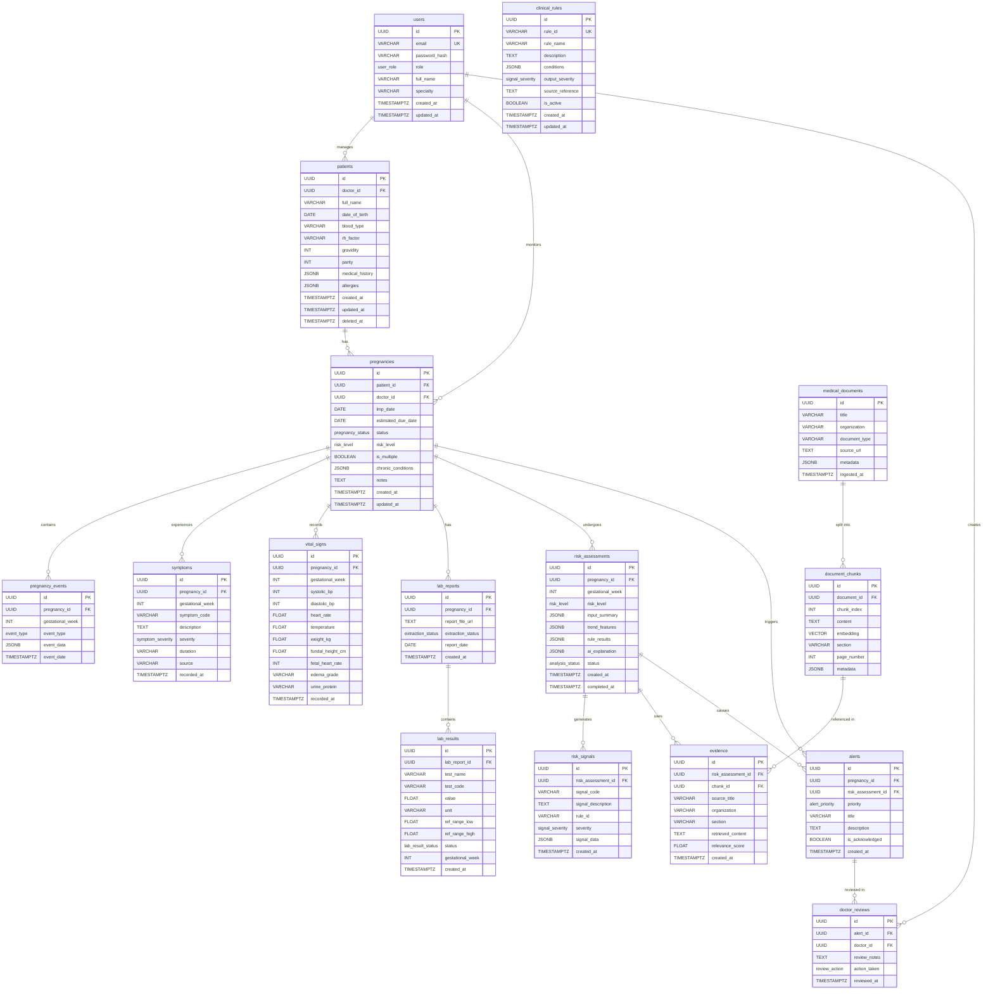

# Database Entity-Relationship Diagram

## Description

The Materna database centers on `pregnancies`, tying a `patient` to temporal measurements like `vital_signs`, `symptoms`, and `lab_reports`. The `risk_assessments` table captures longitudinal evaluation by processing trends and features, producing `risk_signals` and `alerts`. AI insights use `evidence` sourced from vector `document_chunks` belonging to `medical_documents`. Cascade deletes ensure clean longitudinal records when a core entity is removed.
