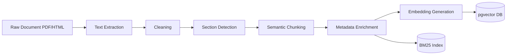

# Document Ingestion Pipeline

## Overview
The RAG pipeline requires highly structured, properly chunked documents to ensure accurate retrieval. The ingestion pipeline processes raw medical guidelines into embedded vectors and BM25-indexed text.

## Source Types & Approved Sources
- **Formats**: PDF, HTML
- **Approved Sources Only**:
  - WHO Maternal Health Guidelines
  - ACOG Practice Bulletins
  - NICE Antenatal Care Guidelines
  - FIGO Publications
  - SMFM Guidelines

## Pipeline Steps
1. **Document Loading**: Fetch via URL or process local file upload.
2. **Text Extraction**: Primary extraction via `pdfplumber`. Fallback to Tesseract OCR for image-heavy pages.
3. **Cleaning**: Strip repeating headers/footers, normalize whitespace, and correct common encoding artifacts.
4. **Section Detection**: Use regex and structural heuristics to identify chapter, section, and subsection hierarchies.
5. **Chunking**:
   - Limit: 512 tokens.
   - Overlap: 50 tokens.
   - Rule: Section-aware boundaries (avoid splitting mid-sentence or mid-paragraph if possible).
6. **Metadata Enrichment**: Tag every chunk with `source_id`, `title`, `organization`, `section`, `page`, and `chunk_index`.
7. **Embedding Generation**: Process text through OpenAI's `text-embedding-3-small` (1536 dimensions).
8. **Storage**: Write vectors to `pgvector` in PostgreSQL. Write metadata to relational tables.
9. **BM25 Index Update**: Update the PostgreSQL full-text search index for keyword retrieval.

## Pydantic Models

```python
from pydantic import BaseModel
from typing import Optional

class DocumentMetadata(BaseModel):
    source_id: str
    title: str
    organization: str
    publication_year: int
    url: Optional[str]

class ChunkMetadata(BaseModel):
    chunk_id: str
    source_id: str
    section_hierarchy: str
    page_number: Optional[int]
    chunk_index: int
    content: str
```

## Error Handling & Batching
- **Batch Processing**: Large PDFs (100+ pages) are processed in chunks of 20 pages to prevent memory overflow and API rate limits during embedding.
- **Retry Logic**: If the embedding API fails (e.g., 429 Rate Limit), exponential backoff is applied.

## Mermaid Pipeline Diagram


