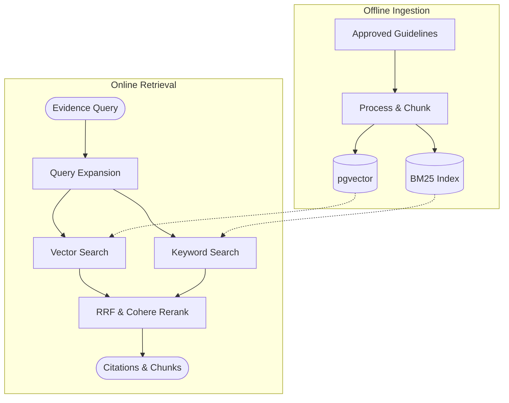
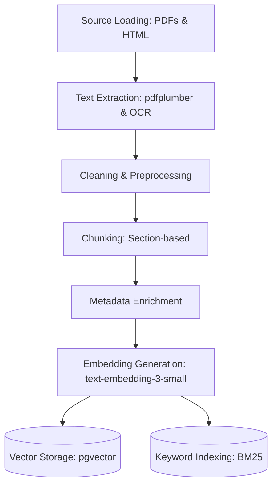
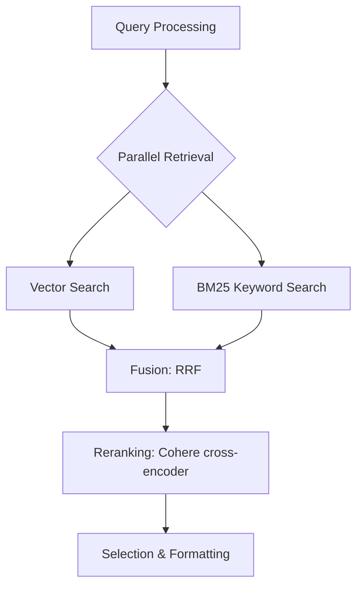

# Maternal Health RAG Pipeline

## Overall RAG Workflow



## Offline Ingestion Pipeline



1. **Source Loading:** PDFs and HTML from WHO, ACOG, NICE, FIGO, SMFM.
2. **Text Extraction:** `pdfplumber` with Tesseract OCR fallback for scanned docs.
3. **Cleaning & Preprocessing:** Remove headers/footers, normalize whitespace.
4. **Chunking:** Section-based chunking; max 512 tokens with 50 token overlap.
5. **Metadata Enrichment:** Attach `source_id`, `document_title`, `organization`, `section`, `page`, and unique `chunk_id`.
6. **Embedding Generation:** `text-embedding-3-small` (1536 dimensions).
7. **Vector Storage:** Insert into pgvector with IVFFlat index using cosine similarity.
8. **Keyword Indexing:** Update BM25 index.

## Online Retrieval Pipeline



1. **Query Processing:** Expand clinical acronyms (e.g., PIH -> Pregnancy Induced Hypertension).
2. **Parallel Retrieval:** 
   - Vector search (cosine similarity, top-20)
   - BM25 keyword search (top-20)
3. **Fusion:** Reciprocal Rank Fusion (RRF, k=60) to merge results.
4. **Reranking:** Cohere cross-encoder reranking to select the top-5 most relevant chunks.
5. **Selection & Formatting:** Apply relevance threshold, preserve citation metadata.

## Pydantic Models

```python
class DocumentMetadata(BaseModel):
    source_id: str
    document_title: str
    organization: str
    url: Optional[str]

class ChunkMetadata(BaseModel):
    chunk_id: str
    document: DocumentMetadata
    section: str
    page: Optional[int]

class EvidenceQuery(BaseModel):
    query_text: str
    clinical_context: Optional[str]

class Citation(BaseModel):
    chunk_id: str
    text_snippet: str
    source_title: str
    organization: str

class EvidenceResult(BaseModel):
    relevant_chunks: List[str]
    citations: List[Citation]
```

## Approved Knowledge Sources
- **WHO:** Recommendations on Antenatal Care.
- **ACOG:** Practice Bulletins (Hypertension in Pregnancy, Gestational Diabetes, etc.).
- **NICE:** Antenatal Care Guidelines.
- **FIGO:** Guidelines.
- **SMFM:** Clinical Guidelines.
- **Emergency References:** Obstetric warning signs.

> **CRITICAL RULE:** NEVER generate fake citations. Every evidence item must be traceable back to one of the approved sources.

## RAG Evaluation Metrics
- **Recall@K:** Ensure critical guidelines are retrieved.
- **Precision@K:** Ensure retrieved chunks are highly relevant.
- **Faithfulness:** Does the Triage Agent's explanation accurately reflect the retrieved chunks?
- **Citation Accuracy:** Are the linked chunks correctly attributed in the final output?
