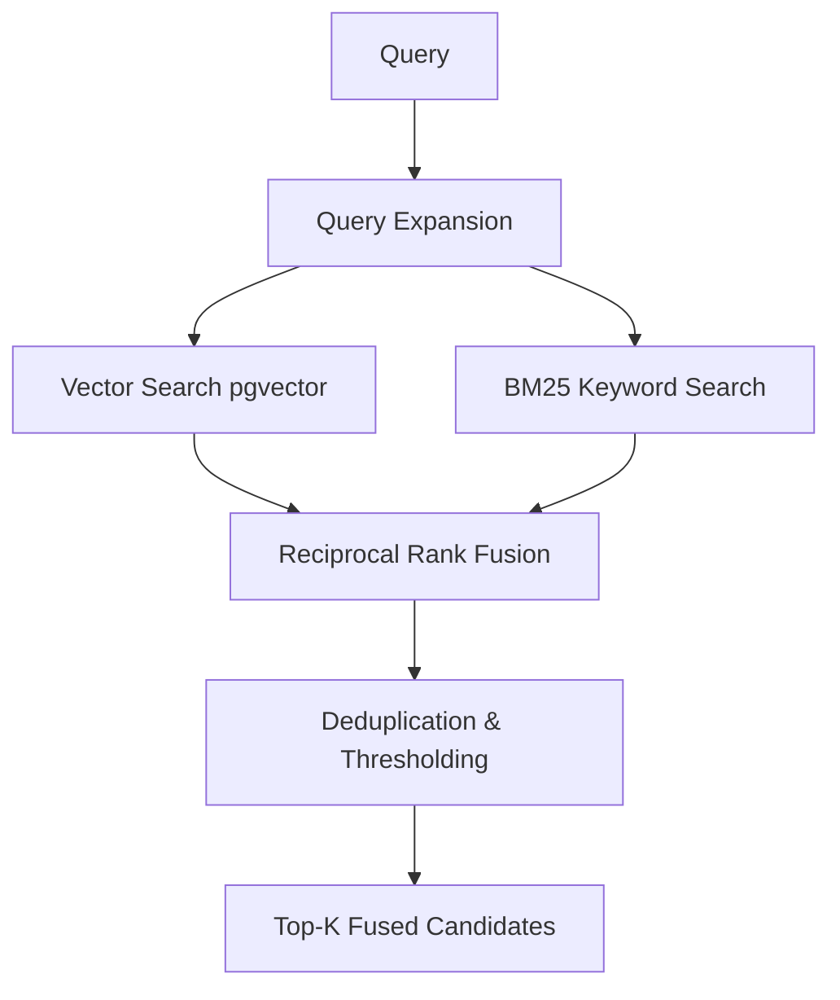

# Hybrid Retrieval Architecture

## Overview
Retrieval in Materna relies on a hybrid search strategy combining dense vector embeddings (for semantic meaning) with sparse keyword retrieval (for exact medical terminology).

## Query Processing
Before executing a search, the query undergoes **Query Expansion**. Medical abbreviations (e.g., "GDM", "PET") are expanded to their full terms ("Gestational Diabetes Mellitus", "Preeclampsia") to ensure both vector and BM25 systems match correctly.

## Parallel Retrieval
Two retrieval methods execute concurrently:
1. **Vector Search**:
   - Uses `pgvector` with cosine similarity (`<=>` operator).
   - Retrieves the top-20 candidates based on embedding distance.
2. **BM25 Keyword Search**:
   - Uses PostgreSQL full-text search capabilities (`tsvector`).
   - Retrieves the top-20 candidates based on exact keyword overlap.

## Fusion & Deduplication
- **Reciprocal Rank Fusion (RRF)**: The two candidate lists are merged using RRF with a standard constant (k=60). This ranks documents highly if they perform well across *both* retrieval methods.
- **Deduplication**: Exact `chunk_id` matches retrieved by both systems are merged.
- **Relevance Threshold**: Any fused result falling below the minimum similarity threshold is discarded to prevent hallucination from irrelevant data.

## Pydantic Models

```python
from pydantic import BaseModel
from typing import List

class RetrievalQuery(BaseModel):
    original_query: str
    expanded_query: str

class RetrievalResult(BaseModel):
    chunk_id: str
    content: str
    score: float
    retrieval_method: str # 'vector' or 'bm25'

class FusedResult(BaseModel):
    chunk_id: str
    content: str
    rrf_score: float
    metadata: dict
```

## Performance Considerations
Both searches operate within PostgreSQL, minimizing network overhead. The target latency for the entire hybrid retrieval phase is `< 800ms`.

## Mermaid Diagram


