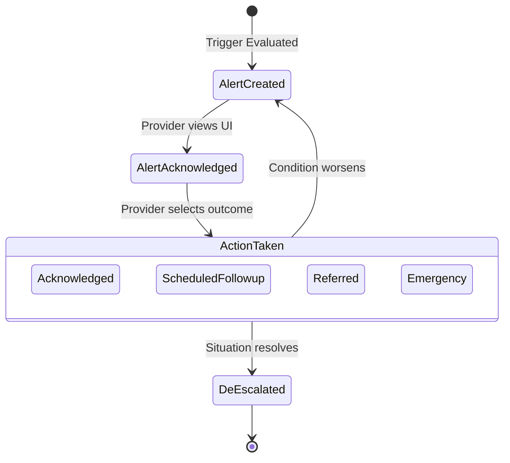

# Smart Escalation Logic

## Overview
The escalation module manages how and when the system alerts healthcare providers based on changes in the deterministic Risk Level. It balances patient safety with the need to prevent "alert fatigue" among clinical staff.

## Escalation Triggers
1. **Immediate Escalation**: Any calculation resulting in a `HIGH_PRIORITY` risk assessment immediately triggers an alert.
2. **Duration-based Escalation**: If a patient remains in the `CLINICAL_REVIEW` status for 2+ consecutive assessments (or > 24 hours), the system escalates the status to a `HIGH_PRIORITY` alert.
3. **Delta Escalation**: If a *new* critical signal is detected, an alert is sent, regardless of whether the patient was already in a high-risk category.

## Escalation Channels (MVP)
- In-app push notification on the Doctor/Provider Dashboard.
- SMS/Email routing for off-hours critical alerts (future phase).

## Alert Lifecycle
1. **Created**: Engine triggers the alert.
2. **Acknowledged**: Provider clicks to view the alert details.
3. **Reviewed**: Provider reads the LLM-generated explanation (Triage Agent output).
4. **Action Taken**: Provider selects a resolution.

## Doctor Review Actions
Upon reviewing an escalated alert, the provider must log an action:
- `acknowledged` (Noted, continuing current plan)
- `scheduled_followup` (Booking patient for an earlier visit)
- `referred` (Sending patient to specialist/hospital)
- `emergency` (Instructing patient to go to ER immediately)

## De-escalation
Risk levels cannot automatically drop from `HIGH_PRIORITY` to `LOW` purely based on a single normal reading. De-escalation requires:
- Clinical review by a provider, OR
- 3 consecutive stable readings over a 24-hour period.

## Alert Fatigue Mitigation
- **Grouping**: Related signals (e.g., BP reading at 10:00 AM and 10:30 AM) are grouped under a single active episode.
- **Debouncing**: Avoid duplicate alerts for the same underlying condition within a 24-hour window, unless the severity explicitly worsens (e.g., BP moves from 145/95 to 165/115).

## Mermaid State Diagram

