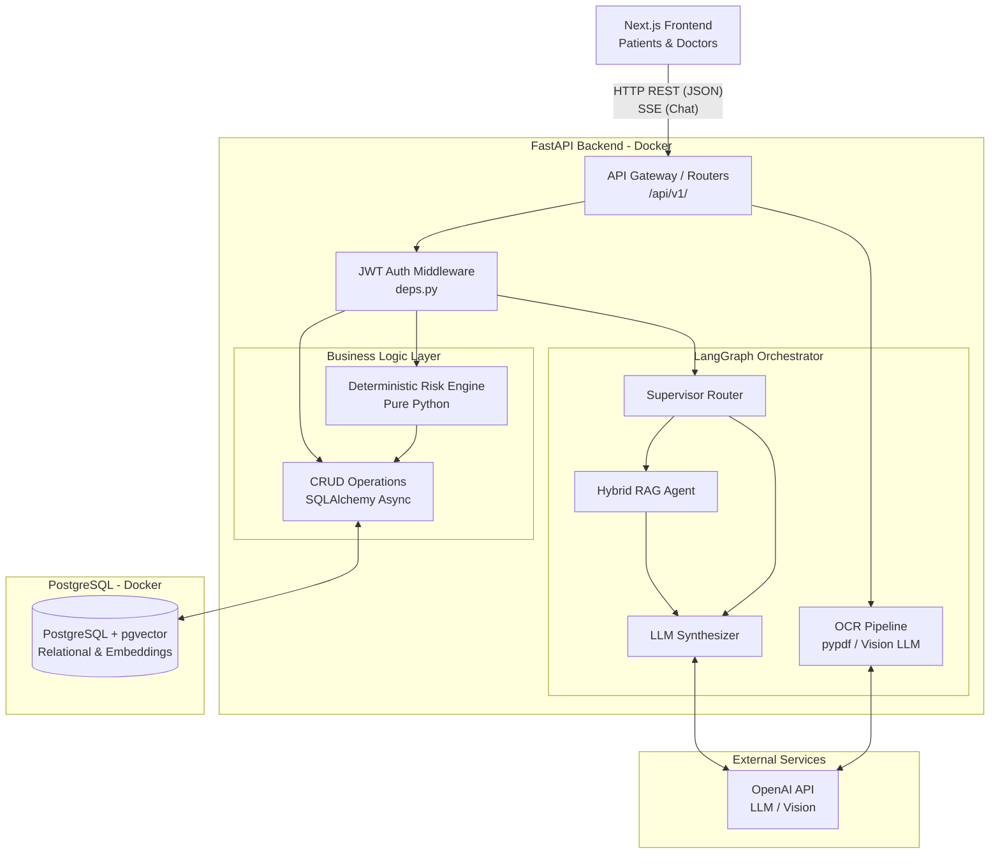

# 05. System Architecture

## Architecture Overview
The Materna system utilizes a modern, monolithic, asynchronous architecture separated into a dedicated frontend and a dedicated backend, containerized via Docker.

*   **Frontend:** A Next.js application that handles user interfaces, client-side routing, and SSE streaming for the AI chat.
*   **Backend:** An Asynchronous FastAPI Python application (`backend/app/main.py`). It acts as the API Gateway, Business Logic executor, and AI orchestrator.
*   **Database:** A single PostgreSQL instance utilizing the `pgvector` extension, managed via SQLAlchemy AsyncSession.
*   **Agents/AI:** Integrated directly into the FastAPI backend using LangChain and LangGraph (`app/ai/graph.py`).
*   **External Systems:** OpenAI / Cohere for LLM reasoning and embeddings.
*   **Authentication:** JWT-based stateless authentication.

## Mermaid Architecture Diagram

## Component Explanations
1.  **API Gateway:** FastAPI automatically handles OpenAPI documentation, request validation via Pydantic, and routes incoming traffic.
2.  **Auth Middleware:** `get_current_user` decodes the JWT and validates roles before allowing access to the business logic.
3.  **Risk Engine:** Operates synchronously to ensure that every vitals check-in is evaluated for safety before the HTTP request completes.
4.  **AI Agent Layer:** Kept within the same monolith to easily access the database and risk engine states, passing an `AgentState` object through the LangGraph nodes.
5.  **Database:** PostgreSQL stores users, patient profiles, daily check-ins, and handles vector embeddings for the RAG retriever.
