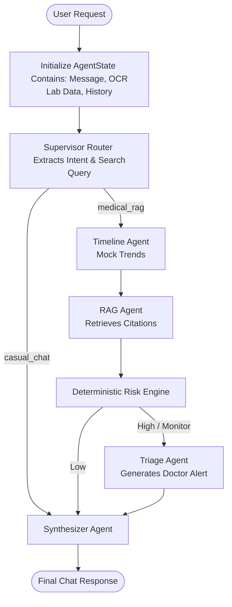

# 06. Agent Architecture

## Agent Architecture Overview
The AI capabilities in Materna are orchestrated using **LangGraph** (implemented in `app/ai/graph.py`). The system uses a state machine approach (`AgentState`) to pass context (including OCR lab data, user message, and retrieved citations) through a sequence of specialized agents.

## Agents Inventory

### 1. Supervisor Agent (Router)
*   **Responsibility:** Reads the user's initial message and determines if the intent is a "medical_rag" query or "casual_chat".
*   **Goal:** Prevent wasting resources on RAG for casual chat, and generate an optimized `search_query` for medical questions.
*   **Input:** `AgentState.user_message`, `AgentState.lab_results`.
*   **Output:** `SupervisorDecision` (route, reasoning, search query).
*   **LLM Provider:** OpenAI/Cohere via `get_generic_llm`.
*   **Dependencies:** None.

### 2. Timeline Agent
*   **Responsibility:** Evaluates patient trends over time.
*   **Status:** [PARTIALLY IMPLEMENTED] - Currently returns a hardcoded mock `TrendFeature`.
*   **Input:** `AgentState`
*   **Output:** `TimelineContext` (Mock trends).

### 3. RAG Agent (Hybrid Retriever)
*   **Responsibility:** Retrieves medical citations based on the search query.
*   **Goal:** Ground the LLM's final response in real medical literature.
*   **Input:** `AgentState.search_query`.
*   **Output:** List of `Citation` objects appended to `AgentState.retrieved_citations`.
*   **Tools:** `HybridRetriever`.
*   **LLM Provider:** Uses embeddings (e.g., OpenAI embeddings).

### 4. Deterministic Risk Engine (Non-LLM Agent)
*   **Responsibility:** Evaluates vitals and lab results against hard clinical rules.
*   **Goal:** Ensure absolute safety without LLM hallucination risk.
*   **Input:** Gestational age, vitals, symptoms, lab results.
*   **Output:** `deterministic_risk_level` (low/monitor/high) and `evaluated_rules`.
*   **Dependencies:** `app/risk_engine/engine.py`.

### 5. Triage Agent
*   **Responsibility:** Generates a concise, professional clinical triage alert if the Risk Engine flags a problem.
*   **Goal:** Provide context for the doctor on the dashboard.
*   **Input:** `deterministic_risk_level`, `evaluated_rules`, `lab_results`.
*   **Output:** `triage_explanation` string.
*   **LLM Provider:** Uses the `MODEL_TRIAGE` LLM.

### 6. Synthesizer Agent
*   **Responsibility:** Formulates the final conversational response to the patient.
*   **Goal:** Provide reassuring, medically sound guidance utilizing all gathered context.
*   **Input:** User message, chat history, OCR lab results, triage alerts, RAG citations.
*   **Output:** `final_chat_response`.
*   **LLM Provider:** Uses `MODEL_RAG` LLM.
*   **Memory:** Retains the last 4 messages of `chat_history`.

## Agent Architecture Graph

