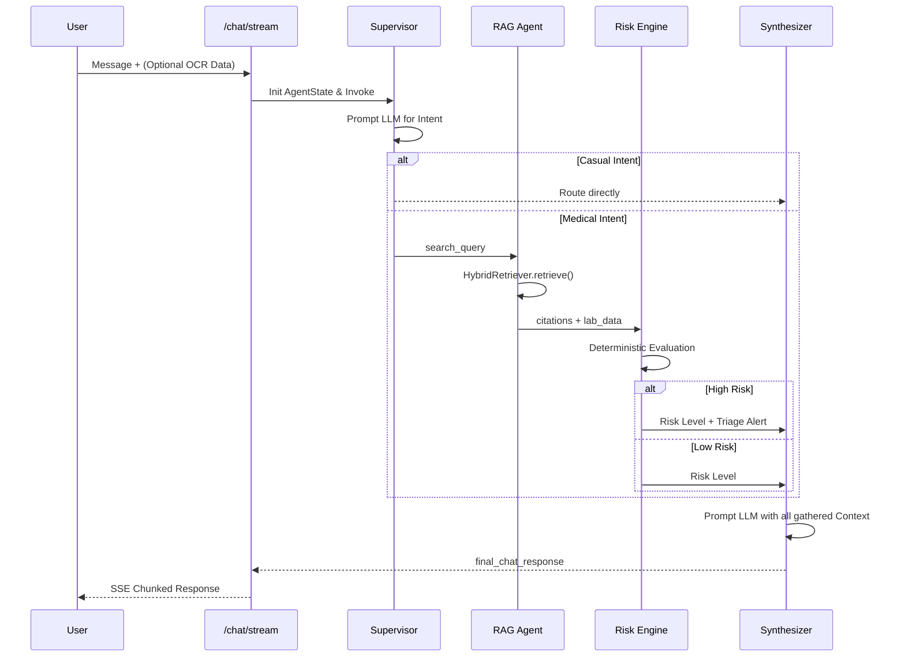

# 07. Agent Workflows

## Full Workflow: AI Chat Assistant

The `materna_graph` inside `backend/app/ai/graph.py` executes a sequential and conditional workflow every time the `/api/v1/chat/stream` endpoint is called.

### 1. Trigger
The workflow is triggered when a User (Patient) sends a message. If the user just uploaded a lab report, the extracted JSON data is included in the initial request payload.

### 2. Input (Initialization)
An `AgentState` object is initialized containing:
*   `execution_id`
*   `patient_id`
*   `user_message`
*   `chat_history` (from the UI)
*   `lab_results` (JSON from OCR, if any)

### 3. Step-by-Step Processing

*   **Step A: Supervisor Node**
    *   **Reasoning:** LLM is prompted to determine if the message is casual or medical. It outputs JSON with `route` and `search_query`.
    *   **Failure Handling:** If the LLM fails to output valid JSON, a `try/except` block catches the error and defaults the route to `"medical_rag"`.
*   **Step B: Timeline Node (If routed to medical)**
    *   **Processing:** Currently a mock pass-through that returns a static `TrendFeature`.
*   **Step C: RAG Node**
    *   **Tools:** Calls `HybridRetriever.retrieve()` using the generated `search_query`.
    *   **Data:** Appends `retrieved_citations` to the state.
*   **Step D: Risk Engine Node**
    *   **Processing:** A pure Python function (`DeterministicRiskEngine.evaluate()`) evaluates any provided lab results or vitals.
*   **Step E: Triage Node (Conditional)**
    *   **Trigger:** Only executes if the Risk Engine outputs `monitor`, `clinical_review`, or `high`.
    *   **Processing:** LLM writes a 2-3 sentence clinical alert for the doctor based on the triggered rules.
*   **Step F: Synthesizer Node**
    *   **Processing:** Compiles a massive system prompt utilizing:
        *   Patient's long-term OCR lab dataset.
        *   Urgent triage alerts.
        *   RAG Context.
        *   The last 4 messages of chat history.
    *   **Failure Handling:** Uses `asyncio.wait_for` with a 25-second timeout. If the LLM times out or errors, it falls back to a deterministic text response that lists out the known lab results and advises consulting a physician.

### 4. Output
The final state outputs `final_chat_response`, `triage_alert`, and `risk_level` which are streamed back to the client.

## Agent Workflow Diagram

