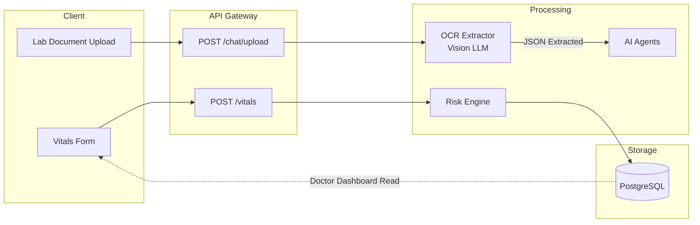

# 09. Data Flow

## System Data Flow
The Materna system handles two primary types of data: **Structured Health Vitals** and **Unstructured Lab Documents**.

### Vitals Data Flow (Structured)
1.  **Source:** Patient enters vitals (e.g., BP, Weight) into the Next.js UI form.
2.  **Ingestion:** Data is sent as a JSON payload to `POST /api/v1/patients/{id}/vitals`.
3.  **Validation:** FastAPI/Pydantic validates data types (e.g., BP must be integers).
4.  **Processing:** `DeterministicRiskEngine` applies clinical logic to determine risk severity.
5.  **Storage:** `create_checkin` function uses SQLAlchemy AsyncSession to save the data in the PostgreSQL database.
6.  **Output:** Risk Level is returned to the Patient UI, and high-risk data is made available to the Doctor Dashboard `GET /api/v1/dashboard/triage`.

### Lab Document Data Flow (Unstructured OCR)
1.  **Source:** Patient uploads a PDF or Image.
2.  **Ingestion:** Sent as `multipart/form-data` to `POST /api/v1/chat/upload`.
3.  **Processing:** Extracted via `pypdf` or Vision LLM.
4.  **Transformation:** LLM converts raw text into a strict JSON dictionary of numerical lab values.
5.  **Agent Consumption:** The JSON dictionary is passed to the LangGraph AI as `lab_results`.
6.  **Storage:** [POTENTIAL ISSUE] Currently, this OCR data is **not** written to the PostgreSQL database. It exists ephemerally in the chat state.
7.  **Output:** AI Synthesizer uses the data to answer patient questions.

## Data Flow Diagram

