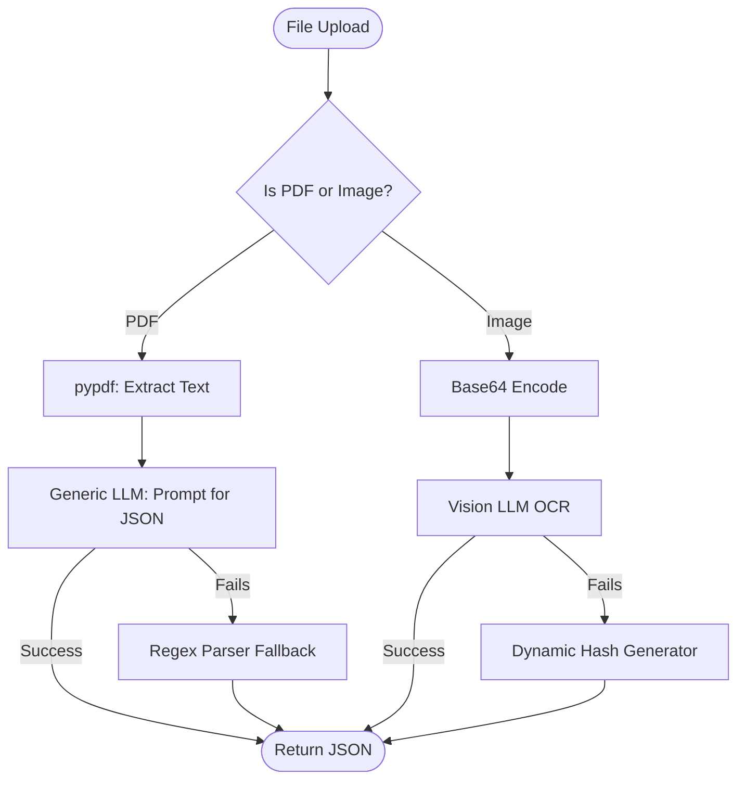

# 10. Ingestion Pipeline

## Lab Report OCR Ingestion Pipeline

The most complex data ingestion pipeline in Materna is the Lab Report OCR endpoint (`/api/v1/chat/upload`), designed to handle both PDFs and images dynamically.

### Pipeline Stages

1.  **Source & Upload:**
    *   **Input:** File (PDF, PNG, JPG) from the frontend via `multipart/form-data`.
    *   **Technology:** FastAPI `UploadFile`.
2.  **Mime-Type Validation & Branching:**
    *   The system checks if the file is a PDF or an Image.
3.  **Extraction Branch A: PDF Text Extraction:**
    *   If PDF, uses `pypdf` to extract raw text locally (fast, free, private).
    *   The extracted text is sent to a generic LLM with a prompt demanding a strict JSON output matching a specific schema (`{"structured_data": {"Test Name": "Value"}}`).
    *   **Fallback:** If the LLM fails, it falls back to a deterministic Regex function (`parse_lab_text_dynamically`).
4.  **Extraction Branch B: Image Vision OCR:**
    *   If Image, it is base64 encoded.
    *   Sent to a Vision LLM (`get_vision_llm`) with instructions to read the image and output the same strict JSON format.
5.  **Dynamic Fallback (Hash-based):**
    *   If all processing fails, the system generates a unique MD5 hash of the file contents.
    *   It uses mathematical modulo operations on the hash to generate "dummy" lab results (e.g., Hemoglobin, Platelets) that are mathematically tied to the specific file. This ensures that uploading the same dummy file twice returns the exact same dummy lab results, mimicking a real database retrieval.
6.  **Output:**
    *   Returns the structured JSON to the client.

## Pipeline Diagram

