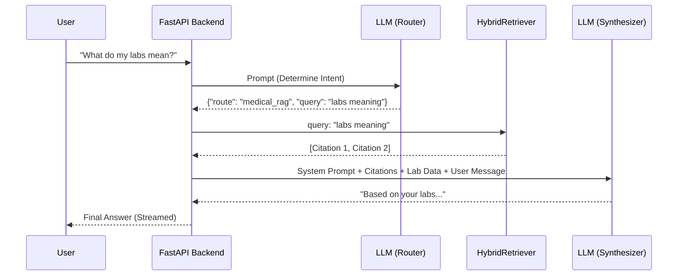

# 11. AI & LLM Flow

## AI/LLM Architecture
Materna's AI capabilities are powered by a multi-agent LangGraph architecture combined with independent Vision LLM calls for OCR.

### LLM Configurations
*   **Providers:** OpenAI (default fallback) / Cohere.
*   **Models:** Configurable via environment variables (e.g., `MODEL_RAG`, `MODEL_TRIAGE`).
*   **Agent Framework:** LangGraph (StateGraph).

### Core LLM Use Cases
1.  **Routing (Supervisor Node):** Zero-shot classification to determine user intent.
2.  **Triage Alert Generation:** Summarization of clinical rules into a human-readable alert.
3.  **Synthesis:** Complex generation combining RAG context, chat history, and OCR JSON data.
4.  **Vision OCR:** Extracting structured JSON from images.

### Prompting Strategy
*   **Strict JSON Output:** The Supervisor and OCR prompts explicitly demand strict JSON output (e.g., `Output MUST be a valid JSON object matching this schema`). The backend strips markdown formatting before parsing via `json.loads()`.
*   **Context Injection:** The Synthesizer system prompt dynamically grows based on the presence of OCR data, RAG citations, or Triage Alerts in the `AgentState`.
*   **Guardrails/Fallbacks:**
    *   If the Synthesizer LLM times out (25 seconds) or fails, a deterministic fallback function kicks in, echoing back the known lab results to the user.
    *   If the Vision LLM fails to parse an image, a dynamic fallback generator uses a file hash to create "dummy" data so the flow does not crash.

### Memory
*   **Short-term Chat History:** Maintained by the frontend UI and passed directly in the payload (`req.chat_history`). Only the last 4 messages are retained to prevent token overflow.
*   **Long-term Context:** Lab results and deterministic risk levels are passed into the `AgentState` on every request.

## AI Request Flow Diagram

