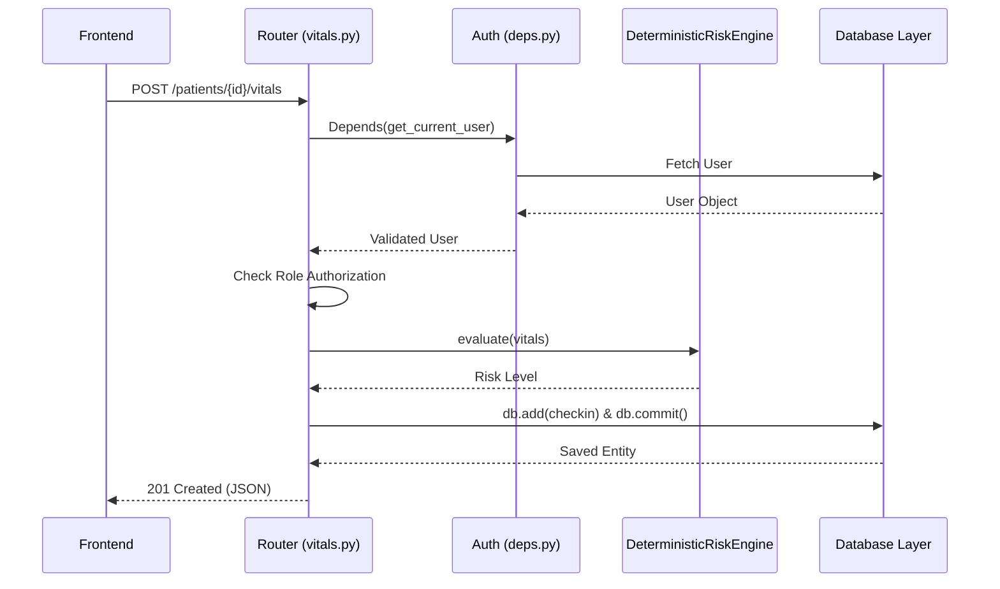

# 12. Backend API Flow

## Backend Request Lifecycle
The backend is built with asynchronous FastAPI. Every request follows a specific lifecycle from the HTTP router down to the database and back.

### The Standard REST Flow (e.g., Vitals Submission)

1.  **Frontend:** Next.js fires an HTTP POST to `/patients/{id}/vitals` with a Bearer Token.
2.  **API Gateway (FastAPI):**
    *   Pydantic validates the JSON payload against `DailyCheckInCreate`.
    *   Dependency Injection (`Depends(get_current_user)`) intercepts the request.
3.  **Auth Middleware (`deps.py`):**
    *   Decodes the JWT to find the `sub` (User ID).
    *   Queries PostgreSQL (`get_user_by_id`) to ensure the user is active.
    *   Returns the `User` object.
4.  **Controller (`vitals.py`):**
    *   Verifies that if the user is a `PATIENT`, they are only modifying their own ID (403 Forbidden otherwise).
    *   Checks if a check-in already exists for today (409 Conflict if true).
5.  **Service / Business Logic:**
    *   Calls the `DeterministicRiskEngine.evaluate()` synchronously.
6.  **Database (`crud/daily_checkin.py`):**
    *   Executes `await db.commit()` and `await db.refresh()` to persist the check-in and update the patient's risk status.
7.  **Response:**
    *   Returns `VitalsLogResponse`.

## Backend Flow Diagram

