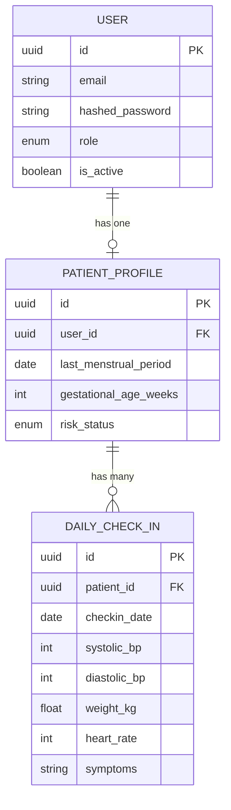

# 13. Database & Data Model

## Database Architecture
Materna uses a single **PostgreSQL** database instances enhanced with the **pgvector** extension (used for storing and querying embeddings in the RAG pipeline).
The database interaction is managed via **SQLAlchemy Asynchronous ORM**.

## Core Entities
1.  **User:** Handles authentication and role-based access. Contains email, hashed password, and an Enum for Role (`PATIENT`, `DOCTOR`, `MIDWIFE`).
2.  **PatientProfile:** Connected 1-to-1 with `User`. Stores clinical baseline data such as Last Menstrual Period (LMP), Gestational Age, and the current overall `risk_status`.
3.  **DailyCheckIn:** Connected Many-to-1 with `PatientProfile`. Stores the time-series data for daily vitals (blood pressure, weight) and reported symptoms.

## Read/Write Patterns
*   **Write-Heavy:** DailyCheckIn table (patients logging vitals daily).
*   **Read-Heavy:** PatientProfile table (doctors loading the triage dashboard, sorting by `risk_status`).

## Missing Entities / Unverified Models
*   [NOT VERIFIED] There is no database model found for persisting the **OCR Lab Results**. The lab results are currently handled as ephemeral JSON inside the LangGraph state.

## Entity Relationship Diagram (ERD)

