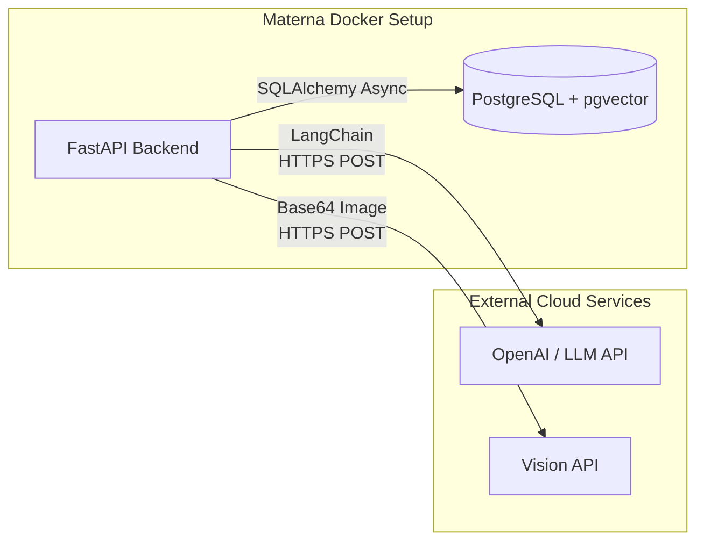

# 14. Integrations

## External Integrations Inventory

The Materna `backend/app` relies on specific external services to function.

### 1. OpenAI (LLM Provider)
*   **Purpose:** Provides the core reasoning capabilities for the LangGraph agents (Supervisor, RAG, Triage, Synthesizer).
*   **Communication:** HTTPS REST calls via `langchain-openai` library.
*   **Data Exchanged:** Prompts, patient conversational history, RAG context, and JSON structures.
*   **Authentication:** Environment variable (`LLM_API_KEY`).
*   **Failure Behavior:** Handled via `try/except` blocks in the graph nodes, utilizing hardcoded deterministic fallback messages if the API timeouts or returns an error.

### 2. OpenAI / Vision LLM
*   **Purpose:** Used in the `/api/v1/chat/upload` endpoint to perform OCR on image-based lab reports.
*   **Communication:** HTTPS REST calls (sending base64 encoded images).
*   **Data Exchanged:** Base64 image payload sent; JSON structured data returned.
*   **Failure Behavior:** If the Vision model fails, the system executes a mathematical modulo fallback algorithm based on the file's hash to generate dummy data.

### 3. PostgreSQL (Infrastructure Integration)
*   **Purpose:** Core relational data storage and vector storage via `pgvector`.
*   **Communication:** `postgresql+asyncpg://` protocol over TCP (port 5432).
*   **Authentication:** Basic Auth configured in `docker-compose.yml`.

## Integration Architecture Diagram

