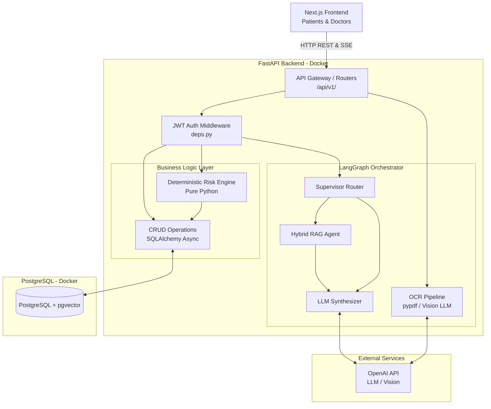
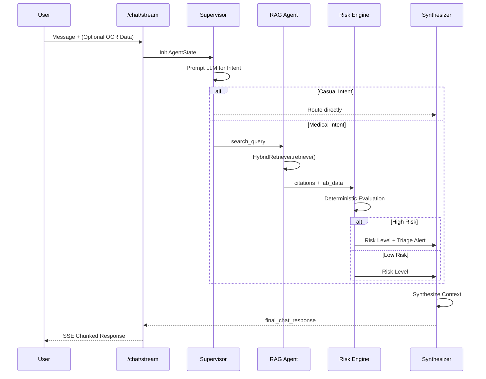
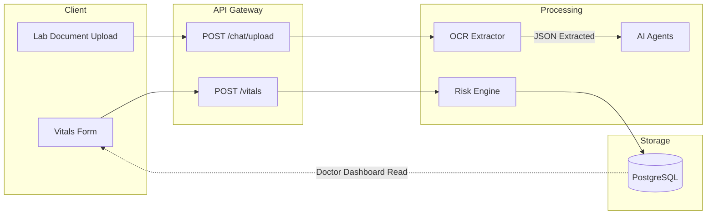
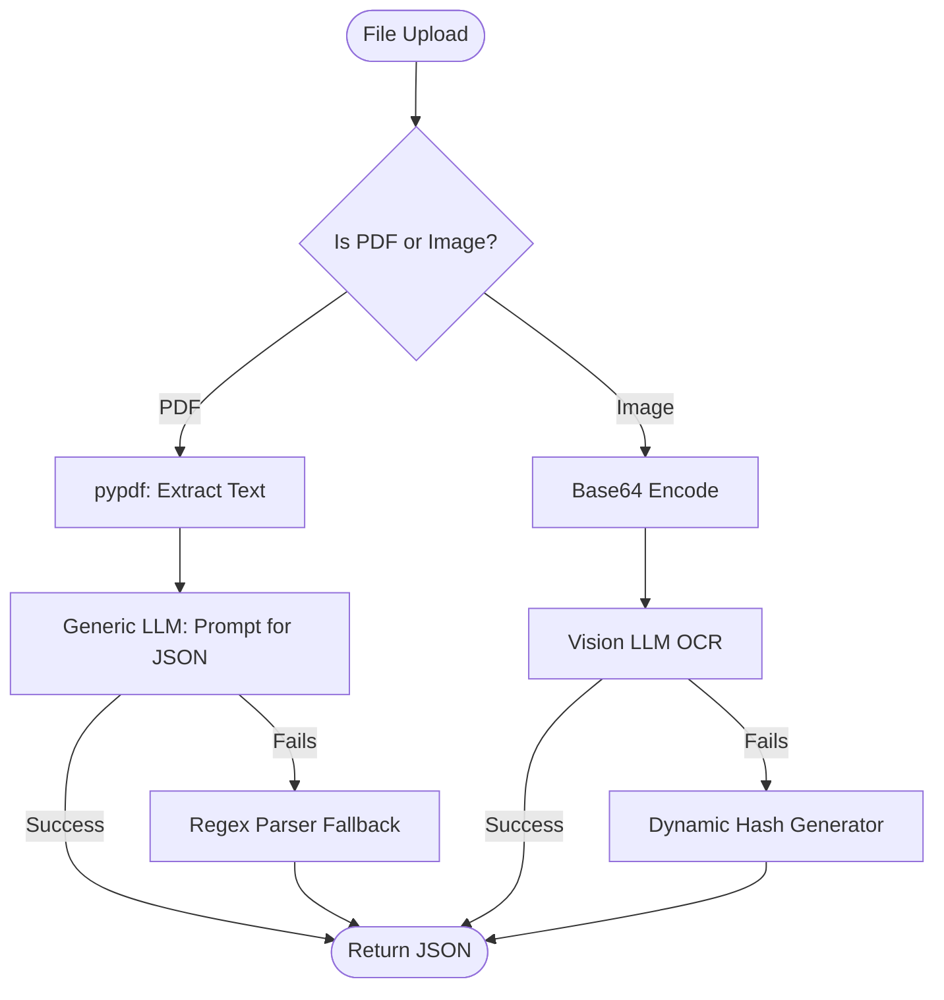
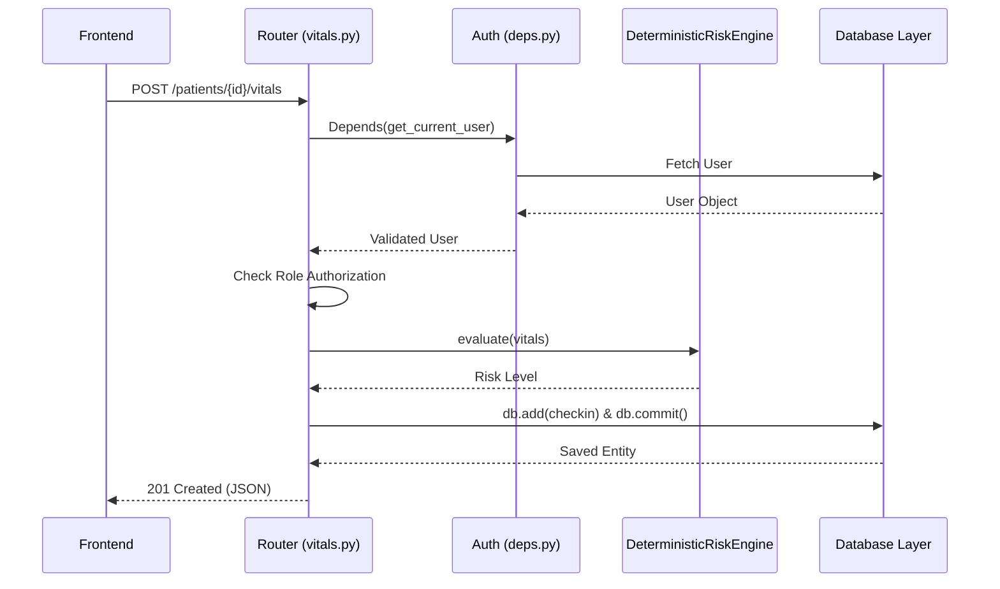
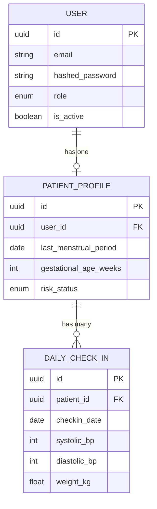

# 20. Presentation Diagrams Aggregation

This document aggregates all Mermaid diagrams generated in the previous documents, providing a single source for the presentation builder to copy/paste visual assets.

---

### Diagram 1: System Architecture (from Document 05)
*   **Purpose:** Show the high-level technical layout of the system.
*   **When to use it:** Technical Overview slides.

---

### Diagram 2: Agent Architecture & Workflows (from Document 06/07)
*   **Purpose:** Explain the sequential AI flow inside the LangGraph state machine.
*   **When to use it:** Deep dive into the AI Chat Assistant capabilities.

---

### Diagram 3: Data Flow (from Document 09)
*   **Purpose:** Show how clinical data moves from user input to storage.
*   **When to use it:** Explaining data privacy, security, and persistence.

---

### Diagram 4: OCR Ingestion Pipeline (from Document 10)
*   **Purpose:** Highlight the complex logic behind the robust document parsing.
*   **When to use it:** AI technical deep dive.

---

### Diagram 5: Backend API Flow (from Document 12)
*   **Purpose:** Show standard HTTP request lifecycle.
*   **When to use it:** Explaining standard non-AI backend operations.

---

### Diagram 6: Database ERD (from Document 13)
*   **Purpose:** Show database relational structure.
*   **When to use it:** Data modeling discussions.

